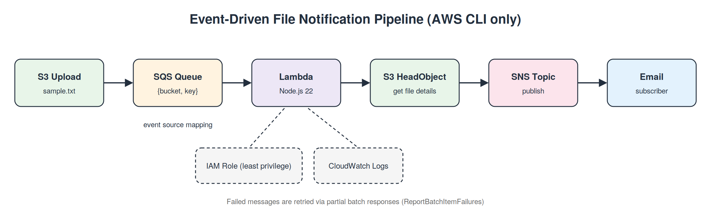

# Event-Driven File Notification Pipeline (AWS CLI only)

`S3 upload → SQS → Lambda → S3 (HeadObject) → SNS → Email`



Everything is created with the AWS CLI. The console is used only to click the SNS confirmation link in the email.

## Prerequisites
AWS CLI v2 (configured), `zip`, `envsubst` (`brew install gettext` on macOS).

## Run
```bash
export EMAIL=you@example.com
./01-storage-messaging.sh   # S3 + upload, SQS + message, SNS + subscribe -> confirm the email
./02-iam-lambda.sh          # IAM role, Lambda, SQS->Lambda mapping
./03-test.sh                # send a fresh message, tail CloudWatch Logs
./99-cleanup.sh             # delete everything
```

Screenshot commands:
```bash
aws s3 ls s3://$BUCKET                                                  # S3 file (run after 01)
aws sqs receive-message --queue-url $QUEUE_URL --visibility-timeout 0   # SQS message (run after 01, before 02)
aws logs tail $LOG_GROUP --since 10m                                    # CloudWatch Logs
```
(`source env.sh` first to load the variables. Blur bucket names, account ids, ARNs and your email before posting.)

## IAM (least privilege)
| Need | Permission | Scope |
|---|---|---|
| Read metadata | `s3:GetObject` (HeadObject needs it) | the single object ARN |
| Proper 404s | `s3:ListBucket` | the bucket ARN |
| Poll queue | `sqs:ReceiveMessage/DeleteMessage/GetQueueAttributes` | the queue ARN |
| Email | `sns:Publish` | the topic ARN |
| Logs | `logs:CreateLogStream/PutLogEvents` | the function's log group |

The log group is pre-created by the CLI, so `CreateLogGroup` is not granted. The only wildcard is the `:*` log-stream suffix, because stream names are generated at runtime. In production, widen the S3 scope to a prefix such as `uploads/*` instead of one key.

## Error handling
- Invalid JSON, missing fields, or a missing S3 object throws, and the failure is logged as structured JSON.
- `ReportBatchItemFailures` means only failed messages return to the queue; successes are deleted.
- Queue visibility timeout (60s) is greater than the Lambda timeout (10s).
- Next step: add a dead-letter queue with `maxReceiveCount` so poison messages stop retrying.

## Security
No credentials or account ids are stored. `env.sh` reads them at runtime, and policy files are templates.
